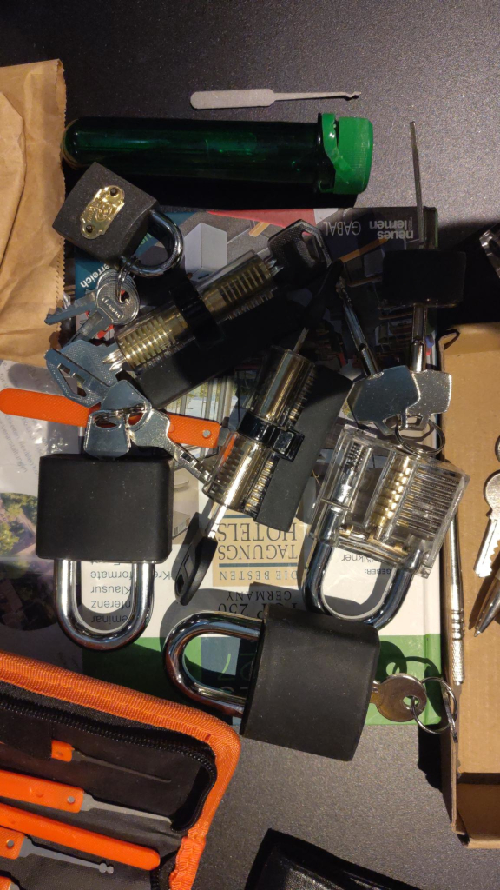
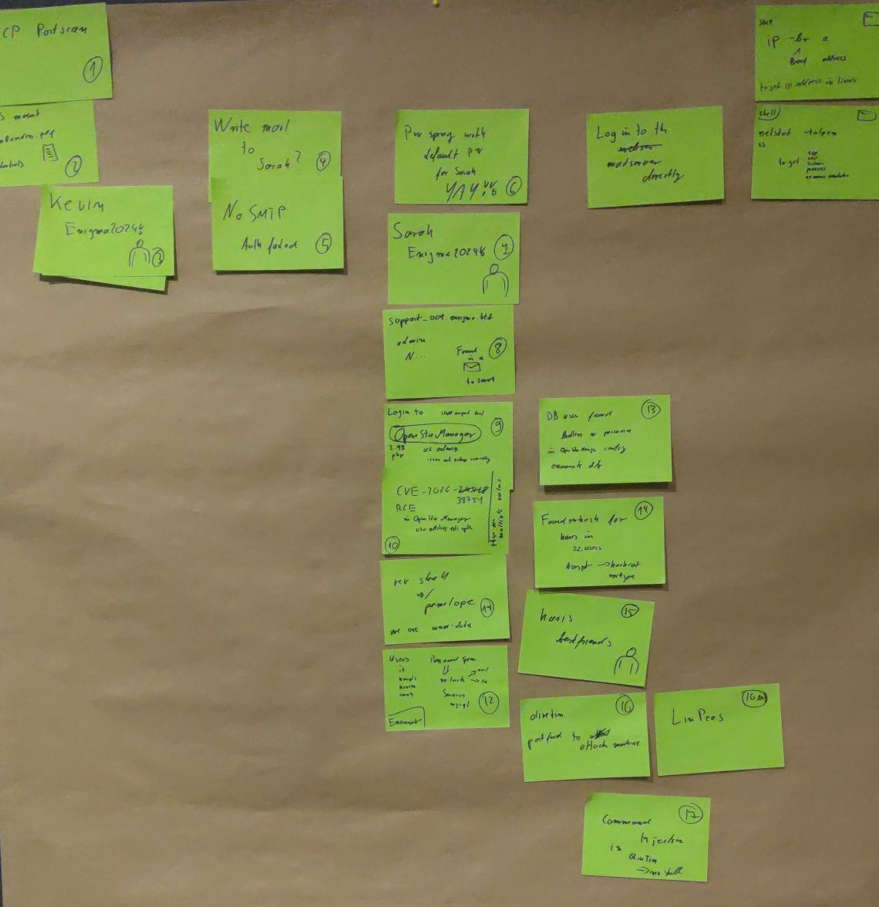

This year the third [open security conference](https://opensecurityconference.org) (OSCO) took place. For me it was the second time I attended. It will have a fixed place in my schedule from now on. 

Last year, I've wrote it is a magical place. I still stand by this verdict. OSCO did not disappoint. Part of this for sure is coming from being an open-space conference. Meaning the participants make up the program. It always surprises me how well this works. And it always gives me hope as it showcases collaboration and knowledge sharing. 

Before I dive into a chronological breakdown, I want to spend some more words on what OSCO means to me. For me it is one of those places to really connect to people. Which I totally like and which is totally exhausting. And which always leads to questioning choices. Which is great. And exhausting.

OSCO is special to me as the focus is on cybersecurity. Which is, despite some people might think, more like a hobby for me - work related but not my primary job. One could think a security conference is all about hacking, regulations, compliance and control. OSCO adds two more things to it. First, a mixture of security professionals, software developers and other people in contact with cycbersecurity. This fosters cross-disciplinary learning and understanding for each other. Second, last year and this year it is also about humans. I felt most of the attendees, if not all were well aware of the socio-technical dimensions of this field. This feels so great. I wish this was more common.

## Day Zero

Thursday, I travelled with my former colleague [Claudia](https://www.linkedin.com/in/claudia-bischoff/) to Aschaffenburg and the by taxi to the conference. After check-in at the hotel it was time to register and meet people. 

At registration OSCO did offer, again, an opt-in sticker for photographs allowed and a [sunflower to indicate non-visible disabilities](https://hdsunflower.com/uk/). My feeling this year was, more people used the sunflowers. Also communication cards were available one can use in case they cannot express themselves at the moment. All of these things fit so nicely in the human centred approach. And all of them raise awareness for different needs. Well done.

After dinner and connecting to the first people both keynotes took place.

### The day everything stops

[Stephanie Carstensen](https://www.linkedin.com/in/stephanie-carstensen/) gave the opening keynote. She told us about "The Day Everything Stops: Preparing for the Cyber Crisis You Hope Never Comes".  
  
Stephanie delivered a very convincing and well crafted presentation about why crisis responses should be trained and where it might break down if not. There were even interactive parts in it!  I loved it. Those short discussions and questions got one really thinking and also alert.
  
While her presentation was centred on OT security topics I am quite sure a lot of those concepts are valid for many more areas. What stuck most with me was the sentence 

**"The difference is not better people, it is prepared people!"**
  
Throughout the rest of the conference I overheard or was part of small discussion on this topic and the question why the information technology industry seems to struggle to learn from other industries when it comes to OT security (and other things as well).  
  
This was a great opener and set a focus on human interactions instead of rely only on written plans and technological controls. Thank you so much Stephanie

### Building a Penetration Testing Lab in 2026

[Jahmel Harris](https://www.linkedin.com/in/jahmelharris/) did take me down a trip on memory lane when he showed his first home-lab setups before talking more about "Building a Penetration Testing Lab in 2026". He provided us with ideas and safeguards if we want to set up a home-lab on our own.  
  
I really liked he did not provide us with instructions on how to build a home-lab but instead talked about the different needs for the different tasks. Also he shared some of his near misses in isolating the home-lab from the home-network. What a great learning. Thank you Jahmel!  
  
Personally, he also reminded me I wanted to setup network segmentation in my homework properly.

## Day One

After being not too late to bed on the first evening I was well rested when joining breakfast and later the marketplace where the session plan for the first day is formed by the participants. After the market place the conference track started in full.

First session, first day: [Lisi](https://www.linkedin.com/in/lisihocke/) and me decided to go for it and present the current status of the [security card game](https://github.com/Security-Card-Game) we are working on with [Philipp](https://www.linkedin.com/in/philipp-zug-a892161b/). Last year we gathered feedback already and this year [we gathered more](https://github.com/Security-Card-Game/securityDeckGame/issues/36). But even better, [Anne](https://www.linkedin.com/in/ackarpf/) offered us to share ideas about gameplay and mechanics. On Sunday we came to it: Awesome work Anne! Thank you so much!

> Fun fact about this game, the idea took shape in the same room and at the same time [Claudius](https://www.linkedin.com/in/claudius-link/) and [Lisi](https://www.linkedin.com/in/lisihocke/) got talking about a open-space conference with a security focus: 2023 at SoCraTes in Soltau.  [Philipp](https://www.linkedin.com/in/philipp-zug-a892161b/) and me got talking about the game idea on the same day and got lucky enough to have Lisi join us. Thank you both for setting out on that endavour with me.

Next up was a session in which [Kristof](https://www.linkedin.com/in/kristof-van-kriekingen-241939166/) told us about some serious and easy exploitable issues in smart adult toys and teledildonics. It was really frightening how bad they are secured. Not only the toys themselves but also the ecosystem around it. Equally frightening was how less the manufacturers seem to care. Also, even devices where you think they have no camera might have on on the chip. It might not show up in your app, but it might still be accessible via API. 

Next up, I facilitated a session around the topic "LLMs destroyed my team" in which I set out in gather observations and talk about how LLMs changed team-dynamics, work culture and what to do about it or at least how to use those tools in a better way. For me it felt the most shared fear was losing the capability to think and reason together and loose shared knowledge.
One workaround for this came from [Gregor](https://www.linkedin.com/in/gregor-trefs/), he got used to do much more refinements in his teams to foster the habit of still knowing why and how something was built. One participant even handed me a kudos card later on stating the session helped them trusting their sanity as they now know how many others face similar challenges. Thank you so much for that feedback. Sharing and data gathering was a goal for this session! If I find time I might write an article about this whole session. 

> Do you know about kudos cards? I got used to them at SoCraTes and OSCO has them as well. They are small cards on which you can put something for another person to remember. It can be something very simple like thanking for a chat, some applause for a well done session, something you learned or even something deeply personal you want to share. It takes a bit to get used to and might feel strange at first. But then, those cards can be a real good help to remember some situations and people. I also happen to go through them in phases of self-doubt or when my inner critic is screaming at me. It helps. Small gesture, possible strong effect.

The next session I've attended was facilitated by [Mireia](https://www.linkedin.com/in/mireiacanopujol/), and a person I forgot not note the name down (I am truly sorry). In this session we gathered knowledge about security champions programs. What to do with and in  regular meetings? A champion per team or per domain? How to encourage the champions to work together as a team? How to make sure the champions are not the sole person responsible to fix security issues in a team? Actually, I was already sold to the idea of such a program when I heard about it the first time. Sadly, I was never part of such and the company I am working at does not have one. But who knows, with all this information and the contacts I now have I might end up suggestion one at work.

> If you want to know learn more about Security Champions and lessons from opposite trenches you can watch [Lisi's](https://www.linkedin.com/in/lisihocke/) and [Mireia's](https://www.linkedin.com/in/mireiacanopujol/) [talk](https://youtu.be/4vERcT0ewg0) at OWASP Global AppSec EU. I did not watch it myself yet, but knowing them both I am quite sure it is worth your time.

After lunch [Anne](https://www.linkedin.com/in/ackarpf/)  asked the question "How to run a threat modelling session". With this as a current topic I gain experience and also talk about I had to attend this one. And it was worth it. Anne did a great job facilitating and note taking. We talked about which diagrams to bring, Attack Trees, Attacker Personas, the MITRE ATT&CK framework as well as how it can be used in communication with stakeholders. 
[Lucas](https://www.linkedin.com/in/lucas-s-3a920229/) shared a method named "Fortunately/Unfortunately" with the group. Think about it like this: "Fortunately, patients can now access their data online. Unfortunately, the also can access other patients data." You just discovered a threat. Now you fixed the problem, but unfortunately and other opens.
We also talked a bit about what to do if someone says "But you are not supposed to do that" - as in, "We need specialists for this". Guess what, you might not be a specialist but you still can (and should) do threat modelling. Of course, psychological safety is also needed in such a session. And best to a session before implementing the feature. It is easier to build something better from the start, then criticise and fix things people already put work into it

For the last session of the day I attended  [Lisi's](https://www.linkedin.com/in/lisihocke/) "Capture the Flag (Beginners Edition)". For me it felt a bit like coming full circle. I've attended such a session at SoCraTes 2023, little did I know this to be a constant hobby since then. For the beginners edition Lisi takes some challenges from the Hack The Box starting points and is the hands (or 'smart input device') for the whole group. There is always something to be learned. Be it some technical knowledge, tools or facilitation skills. 
Lisi is doing such an awesome job in giving enough room and try to take the whole group into account. This starts with setting the stage, asking people to explain their motivation to do things or to explain certain techniques. I am always truly in awe - and I always learn something about facilitating such a group session.

Evening news concluded the official session schedule. But open-spaces do not end with that. As we are all in the same hotel and also have rooms during the night, the fun can continue.

For me, it started after dinner and a quick nap with giving a very short introduction into lock-picking. We had some picking sets and training locks at the game table. And while I am not very good at it, I can still give a very short introduction to get people started and exploring this topic. Like last year, other, more experienced people showed up and knowledge was shared. From then on you could find people during the whole conference trying to get locks open. Wonderful. And to me an example of how creating opportunities and space can facilitate learning, even when you are not an expert on that topic.

I then joined the continuation of the capture the flag session. Again, [Lisi](https://www.linkedin.com/in/lisihocke/) acted as hands for the whole group. We finished the starting point challenge and started a new one which we finished around two in the night. I did learn some things about PHP during both sessions and had a lot of fun.

## Day Two

Second open-space day. Second marketplace. I was not as well rested as the day before but also did not plan to offer sessions on that day. 

The first session started off with a discussion about how companies are implementing the Cyber-Resilience-Act (CRA). This was facilitated by [Clemens](https://www.linkedin.com/in/clemens-huebner/). I learned a lot about what is in scope and what is needed. It encompasses a lot. If you are working anywhere with software (or hardware) which might be affected by the CRA. Read up, start implementing now. Even if you can categorise your product in a low category. You might need things like, vulnerability management, SBOMs, threat models, risk calculation and management. And you will need a plan how to notify authorities on incidents.

Next up was a session on "Automating Governance". [Anne](https://www.linkedin.com/in/ackarpf/) facilitated this discussion again. Honestly, I must say my view on Governance was way to narrow. We started with vulnerability scans, SBOM and then went over open policy agents, red canary and nemesis for infrastructure to FMEA (Failure Mode Effect Analysis). I now feel I have to read up on all of them. We also talked about reachability analysis, risk management systems and prioritising fixes into "Now, Next, Never". 
Another takeaway for me was to best never let a pipeline fail by a automatic security scan but let it send the information to another system which then should give the information to the developer when it is easy to decide what to do with it, not during feature development. I liked the idea, cause out of experience if a Trivy scan fails a pipeline the next thing happening is putting this vulnerability into the ignore file. Maybe after having a quick glance at it, maybe after creating a ticket or maybe just to get the pipeline working again as one is in a completely different headspace at that moment.

I then treated myself to "Stop judging and tear down your gates" by [Lisi](https://www.linkedin.com/in/lisihocke/). In this talk she made it very clear that we need to take care of the humans in a socio-technical system. The talk did not disappoint. Lisi managed to balance talking about problems and possible solutions without making it sound too easy and too simple. Attend this talk when you have a chance, or watch it when Lisi posts that is was recorded somewhere.

After lunch, [Jahmel](https://www.linkedin.com/in/jahmelharris/) gave a "Before the Shell" session and explained with an example assignment how he entered and office he was tasked to enter. In this process he also showed off some tools. From HackRF Pro and software defined radio (SDR) software, over NFC card cloning and reader to a piece of paper he used to trigger a light sensor to open a door. I really enjoyed this session and might now have another rabbit hole named SDR to dive into.

Next up, [Jana](https://www.linkedin.com/in/jana-fuerchtenicht/) brought a seemingly very simple system to a threat model session. LLM, MCP and ETL. After a longer discussion we concluded not much has changed. You still need to make sure to isolate data from different tenants, you still need to make sure to limit operations available to users or models. You still need to think about credential management. And it was and still is not a good idea to allow plain SQL queries to be sent by end-users - be it human or LLMs. Thank you for that showcase session!

Last session of the day, last session of the conference. [Claudius](https://www.linkedin.com/in/claudius-link/) hosted a session with games sponsored by [cybersec](https://cybersecgam.com) games. One group ended up playing "Elevation of Privilege" and the other "Elevation of MLsec". As I know and own the first one, I played "Elevation of MLSec" and learned a lot about threats when it comes to systems with AI or LLM models. Lucky me was also able to get one copy of the "Elevation of MLsec" game together with a poster with a data flow diagram. Find me if you want to play any of those.
What I also loved about this games, there were some postcard sized "Threat Record" cards with them. Those cards are a great brainteaser on how to record threats and possible controls in threat model sessions. You can find them [here](https://cybersecgames.com/products/vicar-threat-cards-for-threat-modeling-games).

After the closing of the conference, dinner was served and of course it was not the end of the conference. We still had rooms and energy for another night of evening activities. People had fun with PowerPoint karaoke, board games, ballroom-dancing (including introductions to it - thank you [Claudia](https://www.linkedin.com/in/claudia-bischoff/) and Tino, I  hope I remembered your name right). 
And of course, [Lisi](https://www.linkedin.com/in/lisihocke/) offered a second night of capture the flag. And of course I joined.  Again it was a fun session. This time I took notes on stickies to help us keep track what we have already done and also to see the path to the root flag later. Taking notes helps me a lot in such challenges and I did try this at SoCraTes this year during [Lisi's](https://www.linkedin.com/in/lisihocke/)  CTF sessions already on a Miro board. Doing it on stickies in the room was more fun. And given by the number of photographs taken at the end also helpful. 
Thank you [Lisi](https://www.linkedin.com/in/lisihocke/)  for trusting me doing this and also for encouraging me to do such things.

## The last day

With even less sleep then the night before I managed to go to breakfast twice. First when I got up the first time and again after a short nap. Such open-spaces really wreak havoc on my sleep schedule. This year, there was no session on Sunday morning. We talked, connected and Nick told [Sofia](https://www.linkedin.com/in/sofiaborgaa/), [Mireia](https://www.linkedin.com/in/mireiacanopujol/) and me how to recycle stickies to geometric figures. 

Before Nick drove [Mireia](https://www.linkedin.com/in/mireiacanopujol/), [Lisi](https://www.linkedin.com/in/lisihocke/) and me to the train station, thank you again, it was time to say good bye to [Janina](https://www.linkedin.com/in/janina-nemec-39875316a/) (thank you for the fun card game), [Sofia](https://www.linkedin.com/in/sofiaborgaa/), [Lucas](https://www.linkedin.com/in/lucas-s-3a920229/), [Anne](https://www.linkedin.com/in/ackarpf/), [Claudius](https://www.linkedin.com/in/claudius-link/), [Claudia](https://www.linkedin.com/in/claudia-bischoff) and a lot of others I hope to meet again. Lucky for me, [Lisi](https://www.linkedin.com/in/lisihocke/) and I shared a train to Nürnberg and we had a bit time to wind down and to catch up. What a wonderful end to this conference.

What a wonderful time. It was fun and exhausting and worth every bit of energy spent. Of course I fell into a post-open-space depression and questioning a lot of choice, but as written at the beginning: This is fine. It always takes me a few days to get used to less interactions and also to regenerate from so many interactions and parse some situations. I would not want it different. 

A big thanks to the organisers who did make this happen. You created something beautiful. 

I hope to see some of the people from OSCO latest next year at the same place. I already pre-registered.

